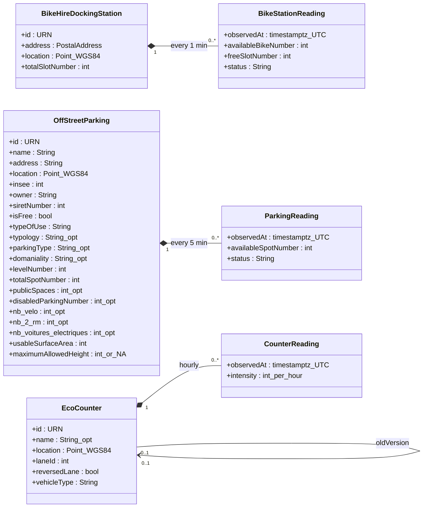

# Data model of the source API

Class diagram of the data published by the Montpellier Méditerranée Métropole API (NGSI-LD), as observed in step 0 (`data/raw/exploration/`, 2026-10-13). It describes the **source data**, not our database schema, which is still an open decision (see `decisions.md`).

How to read it:

- One class per NGSI-LD entity type, holding its static attributes (no timestamp).
- Attributes that carry an `observedAt` timestamp change over time. They are drawn as a separate `...Reading` class, filled from the temporal endpoint (`/ngsi-ld/v1/temporal/entities/{id}`).
- `_opt` marks an attribute missing on some entities, `int_or_NA` a number or the string `"N/A"`. Mermaid does not accept brackets or parentheses in attribute types, hence the underscores.
- Example IDs: `urn:ngsi-ld:station:006`, `urn:ngsi-ld:OffStreetParking:34172-P-001`, `urn:ngsi-ld:EcoCounter:COM23120110`. Observed values: bike `status` is `working`, parking `status` is `Open` or `Full`, `vehicleType` is always `bicycle`.

## Notes

| Element | Fact | Source |
|---|---|---|
| BikeHireDockingStation | 52 entities, all with readings | measured |
| BikeStationReading | `availableBikeNumber + freeSlotNumber = totalSlotNumber` | measured on one station only |
| OffStreetParking | 39 entities. Only 21 have `availableSpotNumber` and `status`: the 18 others have no space guidance system, so 0 readings (temporal endpoint answers 404) | measured + owner |
| OffStreetParking | `domaniality` written `Public`, `public` or `Privé`; `maximumAllowedHeight` can be the string `"N/A"`; `insee` is a number although the spec says string | measured |
| EcoCounter | 70 entities, one per lane. NGSI-LD type is `["EcoCounter", "TrafficFlowObserved"]`. 15 have no `name` | measured |
| CounterReading | `intensity` counts **bikes only**, even at counters named "piéton" or "trottinette". `unitCode` `H10` = per hour | owner |
| oldVersion | 5 counters point to the counter they replace. Gap of 7 to 12 months between old and new: different entities, not one series | measured |
| Readings | Timestamps in UTC. Two consecutive pages of the temporal endpoint share one point: `(entity, observedAt)` must be unique | measured |

Details and figures: `api-findings.md`.
